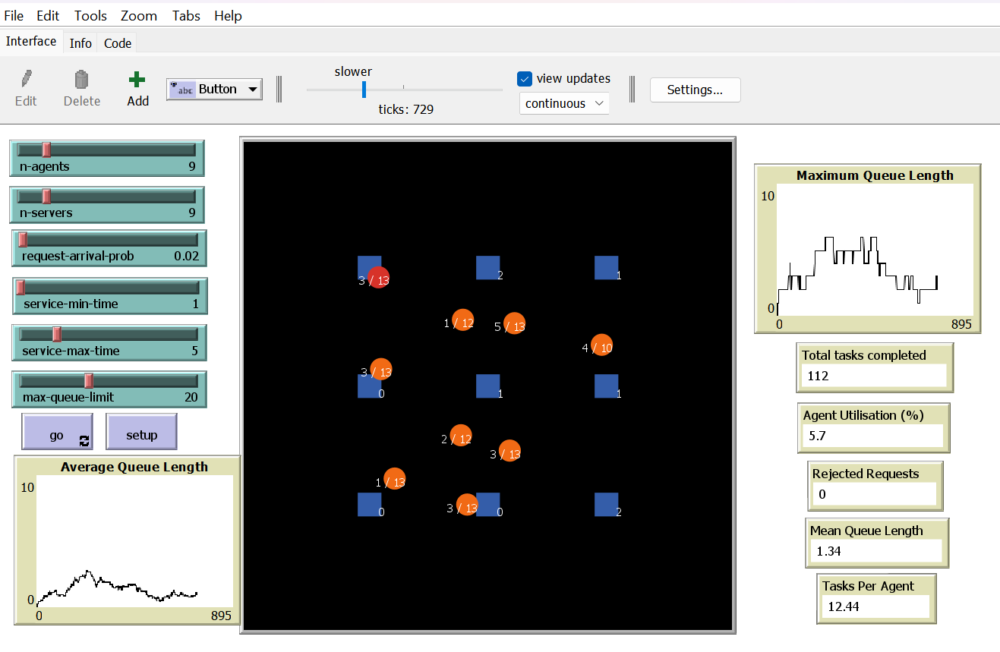

# Multi-Agent Data Centre Simulation

**NetLogo · Agent-based modelling · Performance analysis · BehaviorSpace**

A discrete-time, multi-agent simulation of request processing in a virtual data centre. Autonomous service agents collect requests from server queues, travel to an allocated server and process tasks of varying duration. The model provides live performance metrics and supports controlled experiments investigating congestion, throughput and resource allocation.



## Key technical features

- **Autonomous service agents:** independently identify servers with outstanding work, travel to them and process requests.
- **Request reservation:** an agent reserves a queued request before travelling, preventing two agents from claiming the same request.
- **Probability-based workload:** each server independently receives new request attempts according to a configurable probability while processing time is randomly selected within an adjustable range.
- **Queue capacity management:** servers reject new arrivals when their queues reach the configured limit, leaving the model to track the number of rejected requests.
- **Agent state tracking:** agents distinguish between idle, travelling and processing states and record individual completions, processing time and time spent in each state. States are reflected by agent colour.
- **Performance monitoring:** live plots and monitors report queue lengths, completed tasks, processing utilisation and rejected requests.
- **Repeatable experiments:** NetLogo BehaviorSpace varies model parameters and exports per-run results for analysis.

## How the simulation works

Each tick, every virtual server has an independent chance of receiving one request. A server holds up to `max-queue-limit` queued requests. If the limit has been reached, new arrivals are rejected and a count is incremented.

When an agent is available, it selects a server with at least one **unreserved** request, reserves a request and travels to that server. On arrival, the queued request is collected and processed for a randomly chosen amount of time. The agent then records the completed task and becomes available for another assignment. This is a **random eligible-server allocation policy**, not an optimised scheduling algorithm.

The interface uses **blue squares** for servers, **red circles** for idle agents, **orange circles** for travelling agents and **green circles** for processing agents. Server labels show queue lengths, and agent labels show the last task duration and completed-task count.

### Configurable parameters

| Control | Description |
|---|---|
| `n-servers` | Number of virtual servers in the environment |
| `n-agents` | Number of service agents |
| `request-arrival-prob` | Probability of one arrival attempt per server per tick (e.g. `0.02` = 2%) |
| `service-min-time` | Minimum task processing duration in ticks |
| `service-max-time` | Maximum task processing duration in ticks |
| `max-queue-limit` | Maximum queued requests allowed at each server |

### Performance metrics

| Metric | Meaning |
|---|---|
| Average queue length | Mean queued requests per server at the current tick |
| Maximum queue length | Largest server queue at the current tick |
| Mean queue length over time | Average of the per-tick mean queue length over the run |
| Total tasks completed | Number of requests fully processed |
| Tasks per agent | Completed tasks divided by the number of agents |
| Agent utilisation | Percentage of available agent-ticks spent **processing** (excludes travel and idle time) |
| Rejected requests | Arrivals declined because a server queue was full |

## Running the model

1. Install **NetLogo 6.4.0**, the version recorded in the BehaviorSpace exports.
2. Open [`simulation/DataCentreSimulation.nlogo`](simulation/DataCentreSimulation.nlogo) in NetLogo.
3. Adjust the sliders on the **Interface** tab.
4. Click **setup**, then **go** to run or stop the simulation.
5. Watch the plots and monitors, or use **Tools → BehaviorSpace** to run experiments automatically.

**Reference configuration:** 9 servers, 9 agents, `request-arrival-prob = 0.02`, processing time 1–5 ticks and maximum queue length 20.

## Experimental evaluation

Three investigations were conducted using **BehaviorSpace**, with **five repetitions per configuration** and **1,000 ticks per run** (65 runs in total). Each result below is a mean across five repetitions. All reported findings are specific to these settings.

| Experiment | What changed | Main result |
|---|---|---|
| **1 · Agent allocation** | 1, 2, 5, 10, 20 agents | Completed tasks rose from **17.4** with 1 agent to **162.4** with 10, though adding 10 more agents only increased this value to **164.2**. |
| **2 · Workload scalability** | Arrival probability 0.02–1.00 | At **0.10**, queues approached capacity and **571.4 requests** were rejected per run on average. At **1.00**, average rejections reached **8,657.2**. |
| **3 · Processing complexity** | Service durations 1–5, 5–10, 10–20 ticks | Completed tasks fell from **152.8** to **120.8** as tasks became longer, while processing utilisation rose from **5.14%** to **20.70%**. |

These results show the trade-off between processing capacity, congestion and resource allocation. Under the tested baseline workload, **10 agents offer a reasonable compromise between throughput and agent count**, though doesn't represent a proven universal optimum based on these current experiments. Low processing utilisation suggests that agent travel time may be an important bottleneck, however travel overhead was **not measured in the exported experimental metrics**, so this remains a theory.

For full, detailed reports on each experiment and my findings see **[Experimental Analysis](docs/experimental-analysis.md)**. The corresponding per-run CSV files are included in [`experiments/`](experiments/).

## Project structure

```text
multi-agent-data-centre-simulation/
├── README.md
├── simulation/
│   └── DataCentreSimulation.nlogo
├── experiments/
│   ├── experiment-1-agent-allocation-table.csv
│   ├── experiment-2-workload-scalability-table.csv
│   ├── experiment-3A-short-tasks-table.csv
│   ├── experiment-3B-medium-tasks-table.csv
│   └── experiment-3C-long-tasks-table.csv
├── docs/
│   └── experimental-analysis.md
└── screenshots/
    └── simulation.png
```

## Limitations and future directions

The model uses simplified, probabilistic arrivals and service durations rather than accurate, real-world performance data from a functioning data centre. Agents select eligible servers at random, scheduling approaches such as 'nearest-server' or 'longest-queue-first' allocation have not been compared. Queue capacity is fixed per server, and the model does not simulate request priority, hardware failures or network topology.

Useful next steps include exporting a breakdown of **idle, travelling and processing ticks**, comparing allocation strategies, and testing additional workloads and agent counts. These would help establish whether travel time is the dominant source of overhead.

## Data and reproducibility

The CSV files contain the per-run BehaviorSpace results. Experiments used run-specific seeds and fixed settings within each configuration. Their setup and metric definitions are documented in [Experimental Analysis](docs/experimental-analysis.md). CSV numerical results and run parameters are preserved.
